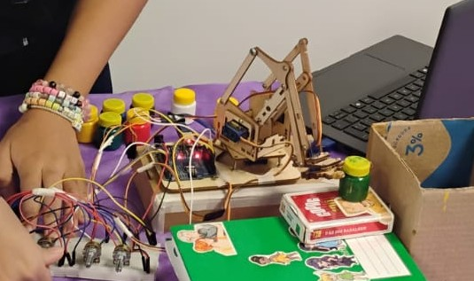
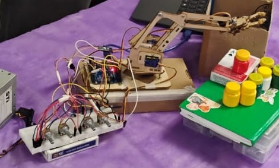
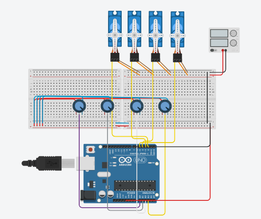
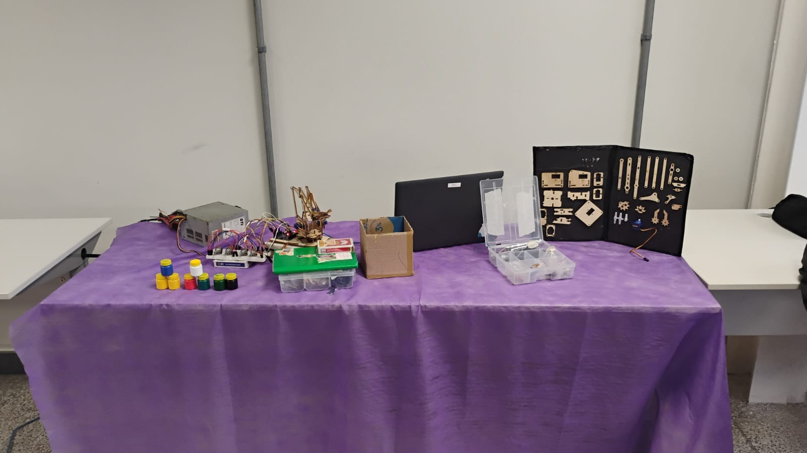

#  Braço Robótico Articulado

>Projeto de braço robótico articulado desenvolvido com Arduino Uno, servo motores e potenciômetros. Usando uma estrutura de MDF. Projeto desenvolvido para uma feira de tecnologia escolar.

## 📌 Sobre o projeto

O **Braço Robótico Articulado** é um projeto desenvolvido com o objetivo de construir um mecanismo capaz de realizar movimentos articulados e manipular pequenos objetos.

O sistema utiliza um Arduino Uno para controlar quatro servomotores e quatro potenciometos,responsáveis pelos movimentos da base, ombro, cotovelo e pinça.

**Objetivo principal:**  
O projeto teve como obijetivo compreender como o maquinario industrial é utilisado no mercado.
Compreender o funcionamento de uma placa arduino, o circuito em si e o codigo utilisado.
Visar o trabalho em equipe, a coopereção, divisão de tarefas e boa comunicação.

**Contexto de desenvolvimento:**  
O projeto foi desesnvolvido para uma feira de tecnologia escolar, como projeto final de ano.

## ⚙️ Funcionamento

O braço robótico possui quatro articulações controladas individualmente:

| Articulação | Função |
|---|---|
| Base | Rotação para os lados |
| Ombro | Movimento para cima e para baixo |
| Cotovelo | Para frente e para trás |
| Pinça | Abertura e fechamento |

O controle é realizado por meio de potenciometros que realizam o movimento dos braços por meio da rotação de seu eixo.

## 🧰 Materiais utilizados

| Quantidade | Componente | Descrição |
|---|---|---|
| 1 | Arduino Uno R3 | Unidade de controle |
| 4 | Servomotores SG90 | Movimentação das articulações |
| 1 | Estrutura de MDF | Corpo do braço robótico |
| 1 | Protoboard | Organização das conexões |
| 31| Jumpers | Conexões elétricas |
| 1 | Cabo USB | Comunicação com o computador |
| 1 | Fonte externa 5 V | Alimentação dos servomotores |
| 4 | Potenciômetros  | [Comando de movimento] |

## 💻 Tecnologias utilizadas

- **Arduino IDE:** desenvolvimento e envio do código.
- **C++:** linguagem utilizada na programação.
- **Arduino Uno R3:** plataforma de controle.
- **Tinkercad Circuits:** simulação e testes do circuito.

## 🔌 Esquema de conexões

| Componente | Pino do Arduino |
|---|---|
| Servo da base | A0 |
| Servo do ombro | A1 |
| Servo do cotovelo | A2 |
| Servo da pinça | A3 |

**Alimentação:** Os servos são alimentados por uma fonte externa de 5 V, foi utilizada uma fonte ATX de computador conectada na protobord do circuito.

**Observação:** na montagem física, os servomotores devem utilizar uma fonte externa adequada, com GND em comum com o Arduino.

## 🚀 Como executar

1. Instale a [Arduino IDE]
2. Conecte o Arduino Uno ao computador.
4. Selecione a placa Arduino Uno.
5. Selecione a porta COM correspondente.
6. Envie o código para o Arduino.
7. Abra o Monitor Serial e configure a movimentação dos servos.
8. Envie os comandos para movimentar o braço.

## 📸 Galeria do projeto

### Braço robótico

### Circuito eletrônico

### Simulação

### Banca da feira

### Equipe

## 🛠️ Melhorias futuras

- [ ] Desenvolver uma interface gráfica de controle.
- [ ] Implementar controle por painel de controle.
- [ ] Melhorar a precisão dos movimentos.
- [ ] Desenvolver movimentos automáticos.
- [ ] Aprimorar a estrutura mecânica.
- [ ] Adicionar novas funcionalidades.

## 👥 Desenvolvedores

| Nome | Responsabilidade |
|---|---|
| [Cauã_de_Souza] | [Ajuda financeira para peças do projeto / Documentação tecnica] |
| [Daniel_Alves] | [Cartaz de decoração para banca] |
| [Yuri] | [Apresentação ] |
| [Kaelmy] | [Apresentação ] |
| [Wellison_Kaua] | [Participou na montagem do braço robótico] |
| [Giovanna] | [Documentação tecnica] |
| [Maria_Elisa_Brandão] | [Termino da montagem do braço / Configuração do codigo C++ / Montagem do circuito / Testes de interação ] |

## 📚 Créditos e referências

Este projeto foi desenvolvido com base em materiais disponibilizados pelo canal **Manual do Mundo**.

- **Código-fonte original:** disponibilizado pelo canal Manual do Mundo.
- **Circuito eletrônico original:** baseado no projeto disponibilizado pelo canal.
- **Referência:** [(https://youtu.be/Ecw3kCo4AdQ?si=Eq94iU00HnrNNgRS)].

O código e o circuito foram utilizados como referência para o desenvolvimento e a realização de adaptações neste projeto.

As modificações, testes, montagem física e demais implementações realizadas estão descritas neste repositório.

⭐ Se você gostou do projeto, deixe uma estrela no repositório!
